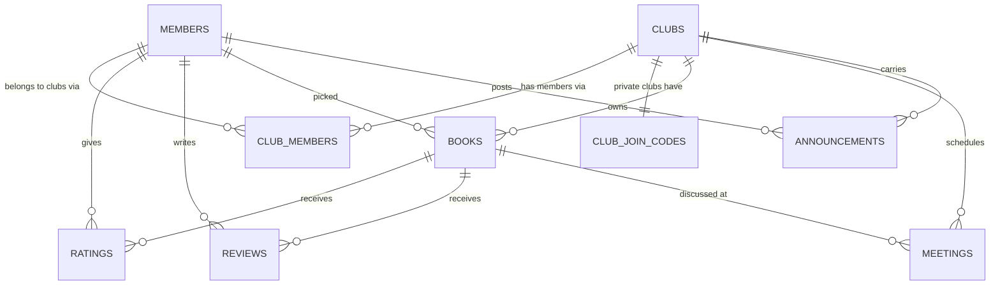

# SCHEMA.md — Database Reference

Plain-language companion to the DDL in `db/migrations/`. **When they disagree,
`db/migrations/` is the source of truth** — this file is for understanding the
shape and the *why*.

**Status legend**
- ✅ **Live** — exists in the Supabase database today
- 📝 **Written** — defined in `db/migrations/`, not yet run

> As of 18 Oct 2026, migrations 0001–0005 are **written but not yet applied**.
> Everything marked 📝 becomes ✅ the moment `docs/RUNBOOK.md` step 2 is done.

---

## Relationships

**What is deliberately absent.** `ratings` and `reviews` have no link to
`club_members` and no `club_id` of their own. A book already belongs to exactly
one club, so a rating is scoped *through* its book. Duplicating `club_id` onto
hundreds of rating rows would create a second place for the truth to live, and
therefore a way for the two to disagree.

---

## `members` ✅ live, 📝 gaining columns

One row per person, across all clubs. Identity is club-independent — which
clubs they belong to and whether they are an admin lives in `club_members`.

| Column | Type | Status | Notes |
|---|---|---|---|
| `id` | `text` | ✅ | Human-chosen slug PK (`'maya'`, `'heenal'`). Predates these migrations; kept rather than changed mid-flight. Constrained to `^[a-z0-9_]{2,40}$`. |
| `name` | `text` | ✅ | 1–60 characters |
| `color` | `text` | ✅ | **Must be `#RRGGBB`.** A real injection guard, not tidiness — this value is interpolated into inline `style` props. |
| `initials` | `text` | ✅ | ≤ 3 characters, for avatars |
| `email` | `text` | 📝 | Unique case-insensitively, partial index so existing nulls do not collide. **This is what links a person to their login.** |
| `auth_user_id` | `uuid` | 📝 | FK → `auth.users(id)`, `on delete set null` — deleting a login never deletes years of reading history |

**Column-level grant:** `authenticated` may update only `name`, `color` and
`initials`. `email` and `auth_user_id` are not updatable by anyone through the
API; the auth trigger sets them.

---

## `clubs` 📝

| Column | Type | Notes |
|---|---|---|
| `id` | `uuid` PK | |
| `name` | `text` | 2–60 chars. Unique among **active** clubs only, via a partial unique index on `lower(btrim(name))`. Deactivating frees the name. |
| `visibility` | `text` | `'public'` (discoverable, join by request+approval) or `'private'` (join by code) |
| `status` | `text` | `'active'` or `'inactive'` |
| `founded_date` | `date` | |
| `created_by` | `text` | FK → `members(id)` — becomes the club's first admin |
| `created_at` | `timestamptz` | |

**No member list column, and no next-meeting column.** Members are a
many-to-many relationship (`club_members`); the next meeting is derived from
the soonest future row in `meetings`. Both are facts that already live
elsewhere, and a copy is a thing that can drift.

---

## `club_join_codes` 📝 — sealed

| Column | Type | Notes |
|---|---|---|
| `club_id` | `uuid` PK | FK → `clubs(id)`, cascade |
| `code` | `text` | 6–20 chars. Generated from `gen_random_uuid()` over a 32-character alphabet with no ambiguous glyphs. |
| `updated_at` | `timestamptz` | |

**RLS on, zero policies, no grants to any role.** Unreachable through the API.
The only access is `public.club_join_code()` and
`public.regenerate_join_code()`, both admin-checked. See DECISIONS.md for why
this is not a column on `clubs`.

---

## `club_members` 📝

The join table that makes multi-club membership, leave-and-rejoin, and per-club
admin all work.

| Column | Type | Notes |
|---|---|---|
| `id` | `uuid` PK | |
| `club_id` | `uuid` | FK → `clubs(id)`, cascade |
| `member_id` | `text` | FK → `members(id)`, cascade |
| `status` | `text` | `'pending'` → `'active'` → `'inactive'` |
| `role` | `text` | `'member'` or `'admin'`, **scoped to this one club** |
| `requested_at` / `joined_at` / `left_at` | `timestamptz` | |

**Unique `(club_id, member_id)`** — one row per member per club, *ever*.
Leaving flips `status`; rejoining flips it back on the same row. That is what
preserves the relationship's history. It does not protect ratings or reviews,
which were never at risk.

**No write policies at all.** Every change goes through an admin-checked
function in `0004_rpc.sql`.

---

## `books` ✅ live, 📝 gaining columns

| Column | Type | Status | Notes |
|---|---|---|---|
| `id` | `integer` identity | ✅ | Seeded in the club's own #1–81 order. **Global, not per club** — display numbers are computed per club at render. |
| `title` | `text` | ✅ | 1–300 chars |
| `author` | `text` | ✅ | Null for all 81 books; the source doc did not reliably have them |
| `picked_by` | `text` | ✅ | FK → `members(id)`, nullable — 10 books genuinely have no recorded picker |
| `status` | `text` | ✅ | `'to_read'`, `'reading'` or `'finished'` |
| `year` | `integer` | ✅ | |
| `club_id` | `uuid` | 📝 | FK → `clubs(id)`, cascade |

**Trigger `books_check_picker`:** a book's picker must be a member of the
book's club. RLS decides *who* may insert; it cannot express a fact about
another table, so a trigger does.

---

## `ratings` ✅ live, 📝 gaining a constraint

| Column | Type | Status | Notes |
|---|---|---|---|
| `member_id` | `text` | ✅ | FK → `members(id)` |
| `book_id` | `integer` | ✅ | FK → `books(id)` |
| `value` | `numeric` | ✅ | `-1000` (jail), or 1–10 in half-point steps |
| `created_at` / `updated_at` | `timestamptz` | 📝 | `updated_at` maintained by trigger |

⚠️ **`ratings_member_book_unique` is load-bearing.** The live table was created
with a surrogate `id` and no uniqueness rule on `(member_id, book_id)`. The app
saves ratings with an upsert, which *requires* a unique index on exactly those
columns — without it Postgres rejects the statement and **every rating edit
fails**. Migration 0001 adds the index explicitly, because on an existing table
the `create table` that declares the primary key is skipped entirely.

The value rule is mirrored by `backend/app/validators.py::is_valid_rating()`.
The database is the authority; the Python version exists to fail fast with a
readable message.

---

## `reviews` ✅ live, 📝 gaining a constraint

| Column | Type | Status | Notes |
|---|---|---|---|
| `member_id` | `text` | ✅ | |
| `book_id` | `integer` | ✅ | |
| `text` | `text` | ✅ | **1–5000 characters.** An abuse and cost control: without a cap one client could write megabytes into a free-tier database. Longest real review is 1,278 characters. |
| `created_at` / `updated_at` | `timestamptz` | 📝 | |

---

## `meetings` 📝

| Column | Type | Notes |
|---|---|---|
| `id` | `uuid` PK | |
| `club_id` | `uuid` | FK → `clubs(id)`, cascade |
| `meeting_date` | `date` | |
| `meeting_time` | `text` | Free text (`"6:00 PM PST"`), ≤ 40 chars |
| `location` | `text` | ≤ 120 chars |
| `book_id` | `integer` | FK → `books(id)`, nullable |
| `created_by` | `text` | FK → `members(id)` |

**No `meeting_number` column.** Display numbers come from date order at query
time, so deleting a meeting renumbers the rest with nothing to update. The home
page countdown reads the soonest row from today onward.

---

## `announcements` 📝

| Column | Type | Notes |
|---|---|---|
| `id` | `uuid` PK | |
| `club_id` | `uuid` | FK → `clubs(id)`, cascade |
| `member_id` | `text` | FK → `members(id)`, cascade |
| `text` | `text` | 1–1000 chars |
| `created_at` | `timestamptz` | |

Replaces the two announcements that were hardcoded in the old `home.html`.
Border colour follows the poster's own member colour.

---

## Row Level Security

| Table | Read | Write |
|---|---|---|
| `members` | Yourself, plus anyone you share an active club with | Your own row, `name`/`color`/`initials` only |
| `clubs` | Any club you are attached to — active, pending or left | **Functions only** |
| `club_members` | Your own rows, plus everyone's in clubs you are active in | **Functions only** |
| `club_join_codes` | **Nobody** | **Functions only** |
| `books` | Active members of the club | Insert/update: any active member. Delete: **admin only** (cascades to reviews) |
| `ratings` / `reviews` | Active members of the book's club | Your own rows only |
| `meetings` | Active members | Any active member |
| `announcements` | Active members | Your own; delete also by admin |

**`anon` has zero privileges on every table**, and every function in `public`
is revoked from it. Two independent reasons the published key reads nothing.

Verify with `db/verify_security.sql` (6 checks) and
`scripts/verify_anon_lockdown.sh` (external proof).
