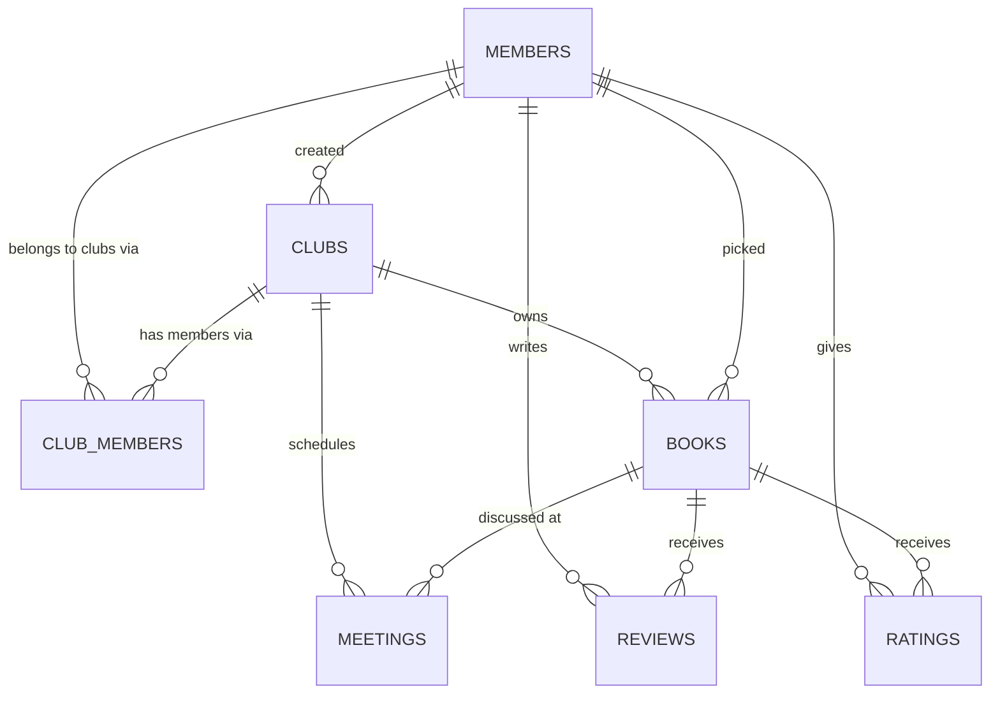

# SCHEMA.md — Database Reference
## Table-by-table reference for the Supabase Postgres database

This is the plain-language companion to the actual DDL in `db/migrations/`.
When they disagree, `db/migrations/` is the source of truth — this file is
for understanding the shape and *why*, not for copy-pasting into the SQL
Editor.

**Status legend:**
- ✅ **Live** — exists in the real Supabase database today
- 🆕 **Drafted** — defined in `db/migrations/0001_multi_club_auth.sql`, not yet run against the live database

---

## Relationships

Note what's *not* here: `ratings` and `reviews` have no direct link to `club_members`. A book already belongs to exactly one club (`books.club_id`), so a rating/review is implicitly scoped through the book it's attached to — no need to duplicate `club_id` onto every rating/review row.

---

## `members` ✅ live, 🆕 gaining columns

One row per person, across all clubs — a member's identity is club-independent; which clubs they belong to and whether they're an admin lives in `club_members`, not here.

| Column | Type | Status | Notes |
|---|---|---|---|
| `id` | `text` | ✅ live | Human-chosen slug PK (`'maya'`, `'mina'`, `'heenal'`), not an auto ID — predates this migration, kept as-is rather than changed mid-flight |
| `name` | `text` | ✅ live | Display name |
| `color` | `text` | ✅ live | Hex color, member's UI color |
| `initials` | `text` | ✅ live | Used for avatar circles |
| `email` | `text` | 🆕 drafted | Unique (case-insensitive, partial index — allows existing null rows) |
| `auth_user_id` | `uuid` | 🆕 drafted | FK → `auth.users(id)`, nullable until the member has a real Supabase Auth account, unique once set — this is the "user key" for finding/cleaning up test accounts |

**Superseded:** the CLAUDE.md "Data Models" table currently lists a global `role (admin, max 3 per group)` field on Member. That model is replaced by `club_members.role` — admin is per-club now, not global. CLAUDE.md should be updated to match once this migration runs.

---

## `books` ✅ live, 🆕 gaining a column

| Column | Type | Status | Notes |
|---|---|---|---|
| `id` | `integer` (identity) | ✅ live | Auto-generated; deliberately seeded in the source doc's own #1–81 order so it matches the doc's numbering |
| `title` | `text` | ✅ live | |
| `picked_by` | `text` | ✅ live | FK → `members(id)`, nullable (~19 books have no recorded picker) |
| `status` | `text` | ✅ live | e.g. `finished` |
| `year` | `integer` | ✅ live | |
| `club_id` | `uuid` | 🆕 drafted | FK → `clubs(id)` — every book now belongs to exactly one club |

`author`, `genre`, `cover_url` mentioned in CLAUDE.md's original Data Model were never actually populated (author isn't reliably known from the source doc) — not live columns today.

---

## `ratings` ✅ live — unchanged by this migration

| Column | Type | Status | Notes |
|---|---|---|---|
| `member_id` | `text` | ✅ live | FK → `members(id)`, part of composite key |
| `book_id` | `integer` | ✅ live | FK → `books(id)`, part of composite key |
| `value` | `decimal(4,1)` | ✅ live | `-1000` (jail, counts as 1 in averages) or `1`–`10` in 0.5 steps — mirrored by `backend/app/validators.py::is_valid_rating()` |

---

## `reviews` ✅ live — unchanged by this migration

| Column | Type | Status | Notes |
|---|---|---|---|
| `member_id` | `text` | ✅ live | FK → `members(id)` |
| `book_id` | `integer` | ✅ live | FK → `books(id)` |
| `text` | `text` | ✅ live | Unique on `(member_id, book_id)` — seeding scripts use `on conflict (member_id, book_id) do nothing` |

---

## `clubs` 🆕 drafted

| Column | Type | Notes |
|---|---|---|
| `id` | `uuid` PK | |
| `name` | `text` | Unique among **active** clubs only (partial unique index on `lower(name)`) — see DECISIONS.md, "reactivating requires a new name" |
| `visibility` | `text` | `'public'` or `'private'` |
| `join_code` | `text` | Only meaningful when `visibility = 'private'`; the code is the join gate, no separate approval step on top of it |
| `status` | `text` | `'active'` or `'inactive'` |
| `founded_date` | `date` | |
| `created_by` | `text` | FK → `members(id)` — the creator, who becomes the club's first admin via `club_members` |
| `created_at` | `timestamptz` | |

---

## `club_members` 🆕 drafted

The join table that makes multi-club membership, soft-delete-on-leave, and per-club admin roles all work. See DECISIONS.md, "Multi-club membership model."

| Column | Type | Notes |
|---|---|---|
| `id` | `uuid` PK | |
| `club_id` | `uuid` | FK → `clubs(id)` |
| `member_id` | `text` | FK → `members(id)` |
| `status` | `text` | `'pending'` (requested, awaiting admin approval) → `'active'` (approved / code-joined) → `'inactive'` (left) |
| `role` | `text` | `'member'` or `'admin'`, scoped to this one club |
| `requested_at` | `timestamptz` | |
| `joined_at` | `timestamptz` | Nullable, set when approved |
| `left_at` | `timestamptz` | Nullable, set when the member leaves |

**Unique constraint:** `(club_id, member_id)` — one row per member per club, *ever*. Leaving/rejoining flips `status` on the same row rather than inserting a new one; that's what preserves the relationship's history. (It does not protect ratings/reviews — those were never at risk, see the table note above.)

---

## `meetings` 🆕 drafted

| Column | Type | Notes |
|---|---|---|
| `id` | `uuid` PK | |
| `club_id` | `uuid` | FK → `clubs(id)` |
| `meeting_date` | `date` | |
| `meeting_time` | `text` | Free text for now (e.g. `"6:00 PM PST"`) |
| `location` | `text` | |
| `book_id` | `integer` | FK → `books(id)`, nullable — optional linked book |
| `created_by` | `text` | FK → `members(id)` |
| `created_at` | `timestamptz` | |

**No `meeting_number` column.** Display numbers (`#1`, `#2`...) are computed at query time via `row_number() over (partition by club_id order by meeting_date)` — see DECISIONS.md, "Meeting numbers are computed, not stored." Deleting a meeting automatically renumbers the rest; there's nothing to update.

---

## Row Level Security status

| Table | RLS | Policy |
|---|---|---|
| `members`, `books`, `ratings`, `reviews` | ✅ enabled | Public read (`using (true)`) — the known, flagged-as-temporary tradeoff from initial seeding, still open |
| `clubs`, `club_members`, `meetings` | 🆕 enabled (drafted) | **No policies yet** — default-deny, inaccessible via the API until step 3 of the auth plan designs real policies scoped by `club_members` |

Full auth rollout plan (schema → Supabase Auth → RLS rewrite → real pages) is tracked in `docs/SESSION_STATE.md`.
